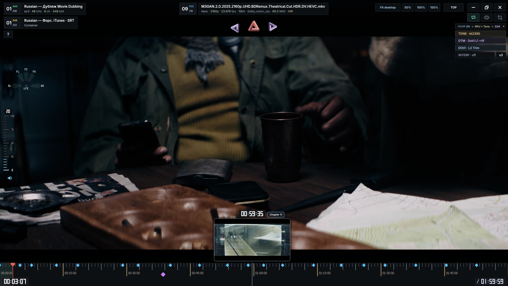
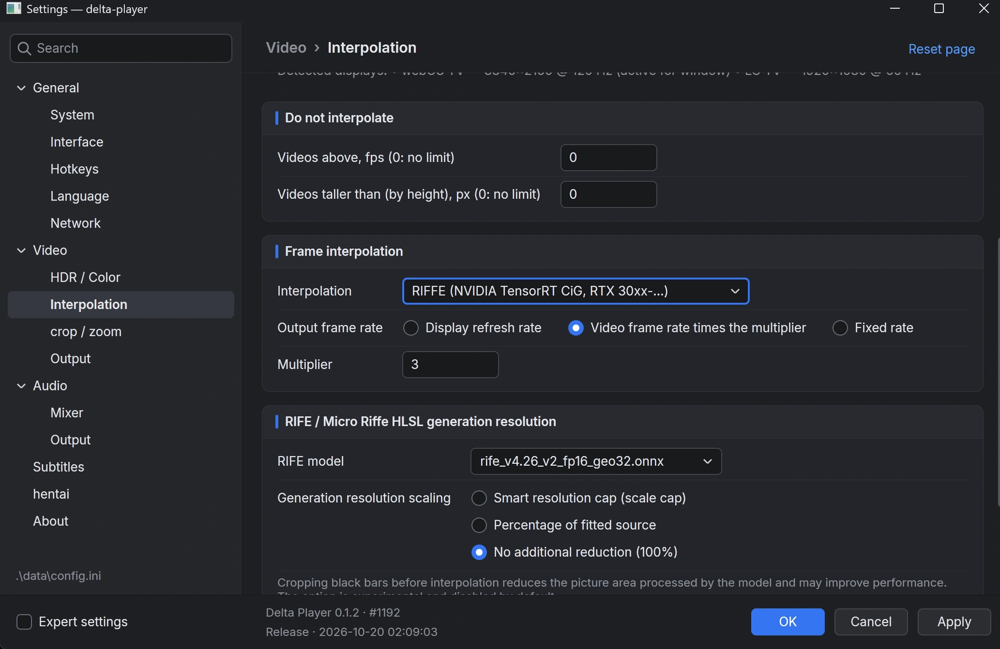
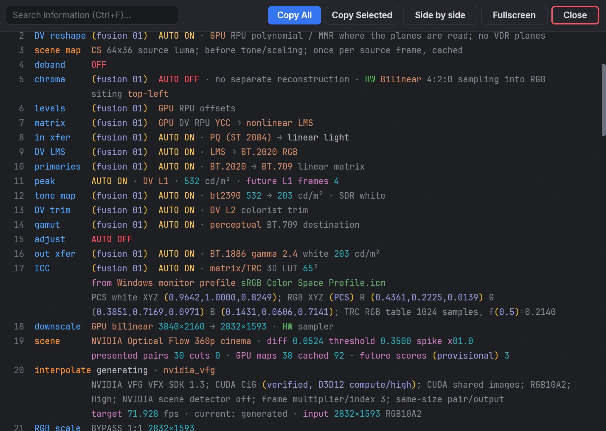
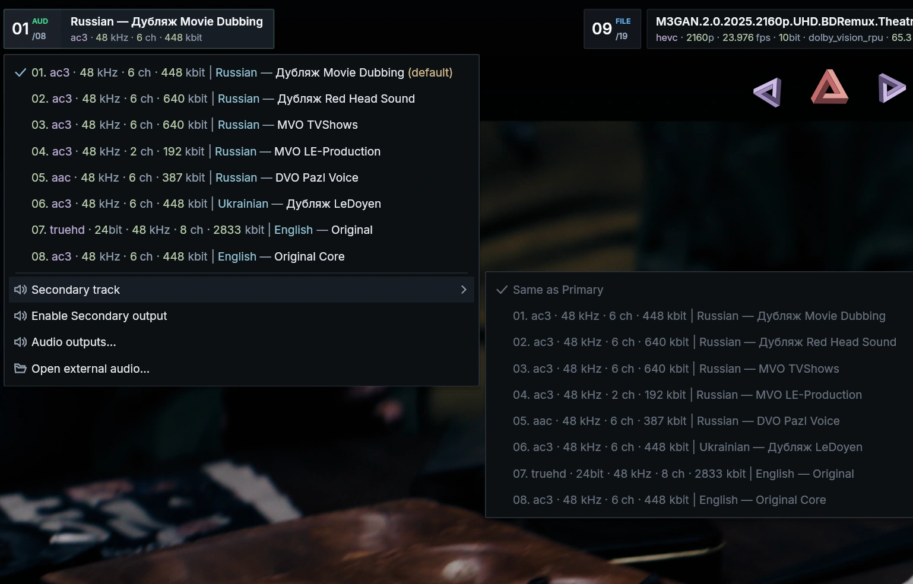
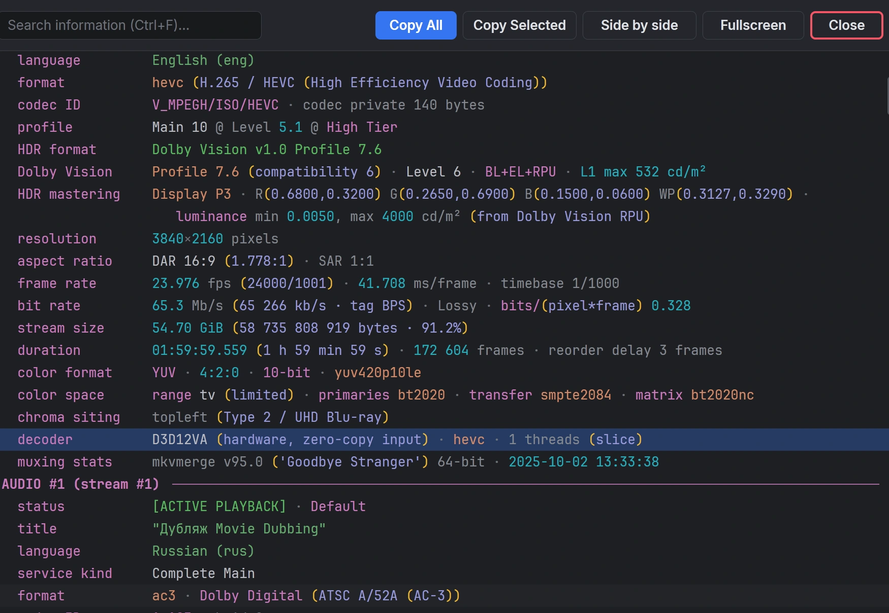
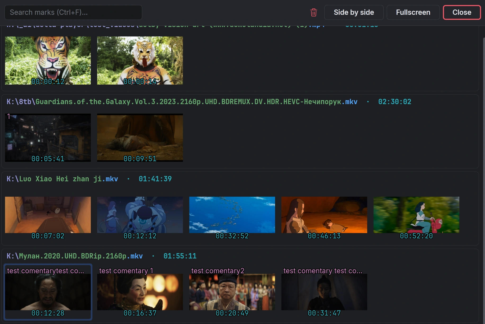
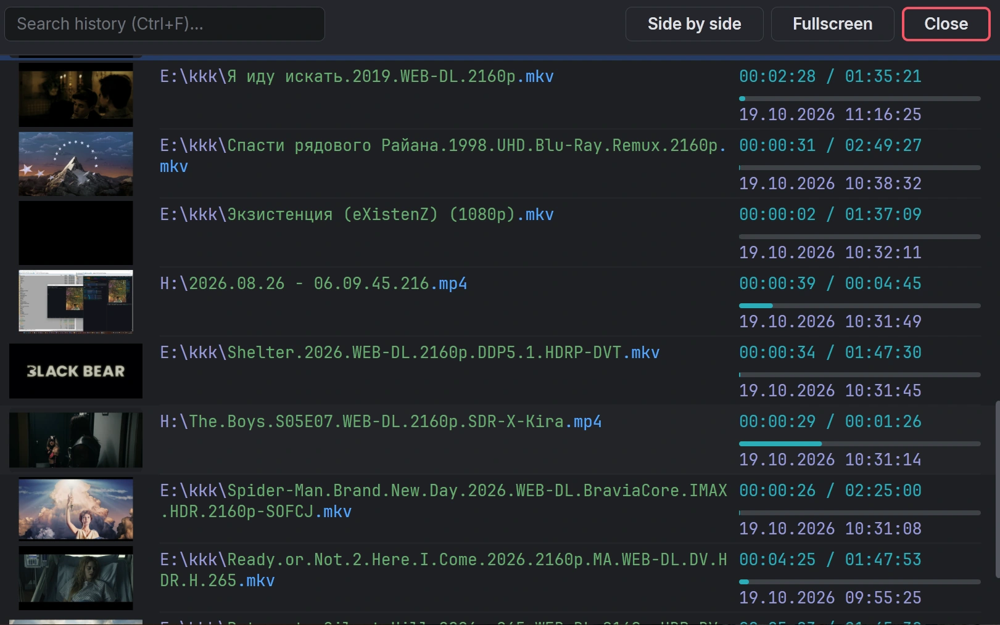
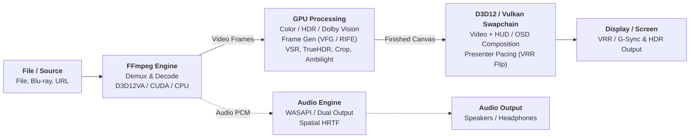

# Delta Player

**Frame generation. RTX video enhancement. Moments worth saving.**

Video player for high-refresh displays, HDR films and a more visual way to navigate your videos.

  

    

| Motion that fits your display | More from your picture |
| :--- | :--- |
| **NVIDIA Video Frame Generation, RIFE and Micro Riffe**, with scene-cut detection to avoid blending across cuts. VRR-aware frame pacing. | **Hardware GPU JPEG 2000 (nvJPEG2000)** for DCI 2K/4K 12-bit cinema streams. **RTX Video VSR + TrueHDR**, HDR10 / HLG, and Dolby Vision. |

<table>
<tr>
<td colspan="2" valign="top">
<strong>Playback HUD</strong>  

</td>
</tr>
<tr>
<td width="50%" valign="top">
<strong>Frame generation controls</strong>  

</td>
<td width="50%" valign="top">
<strong>Pipeline diagnostics</strong>  

</td>
</tr>
<tr>
<td width="50%" valign="top">
<strong>Track routing & dual audio</strong>  

</td>
<td width="50%" valign="top">
<strong>Media information</strong>  

</td>
</tr>
<tr>
<td width="50%" valign="top">
<strong>Marks</strong>  

</td>
<td width="50%" valign="top">
<strong>Watch history</strong>  

</td>
</tr>
</table>

**Around the film:** hardware GPU JPEG 2000 decoding · Blu-ray ISO & 3D MVC · automatic black-bar cropping for ultrawide screens · Ambilight · two independent audio outputs · Steam Audio for headphones · GPU-drawn HUD and native searchable panels.

**Try it:** extract the **whole ZIP**, run `delta-player.exe` or the separate `delta-player-vulkan.exe`, and drop in a video. **F2** → settings; **F1** → controls. Portable data stays beside the app when `portable.ini` is present.

Compatibility

Windows 11 x64. Direct3D 12 requires Feature Level 12_1 / Shader Model 6.6; Vulkan is a separate executable. Features depend on the GPU, driver and display. Native NVIDIA VFG targets GeForce RTX; other interpolation methods have their own requirements. VRR depends on display and driver configuration. Dolby Vision Profile 7 FEL residual is not applied. This is an alpha distribution; AMD and older GPU coverage remains limited.

## Delta Player features

### Architecture and render pipeline

- **File / Source**: Media file, Blu-ray ISO / BDMV folder, or network stream.
- **FFmpeg (Demux & Decode)**: Container demuxing and hardware (D3D12VA / CUDA) or CPU video decoding, audio decoding, and subtitle extraction.
- **GPU Processing**: Color conversions, HDR / Dolby Vision dynamic tone mapping (DTM), neural frame generation (NVIDIA VFG / RIFE), upscaling (VSR, TrueHDR), black-bar cropping, and Ambilight.
- **D3D12 / Vulkan Swapchain**: Video canvas composition with vector HUD/OSD and subtitles; Presenter pacing synchronized with display refresh rate (VRR flip model).
- **Display & Audio**: Tear-free playback on VRR/G-Sync and HDR displays with synchronized WASAPI or dual audio output.

### Video frame interpolation and refresh rate

- **Neural frame generation.** Choose NVIDIA Video Frame Generation (VFG), RIFE, or the lightweight Micro Riffe compute shader. Native VFG targets GeForce RTX GPUs. RIFE runs through TensorRT on compatible NVIDIA GPUs. The Direct3D 12 build also offers DirectML and TensorRT with CUDA in Graphics (CiG).
- **Frame rate and scene cuts.** Target your display's refresh rate, a fixed frame rate, or a multiple of the source frame rate. Adjust the resolution used for generation to suit your GPU. Scene-cut detection can skip interpolation at cuts to avoid blending adjacent shots.
- **VRR and fixed-refresh playback.** Frame pacing supports variable refresh rate (VRR) on compatible displays. Configurable frame repeats let you target a minimum presentation rate or the highest multiple that fits the display refresh rate.

### HDR, Dolby Vision, and picture controls

- **HDR playback and dynamic tone mapping.** Play HDR10 and HLG video, adapt HDR to SDR or HDR displays, and use Dolby Vision RPU metadata from supported profiles with standard HDR10 output. Profile 7 FEL titles play using the HDR10 base layer, with the enhancement-layer residual omitted.
- **RTX Video Super Resolution and TrueHDR.** On compatible NVIDIA GPUs, RTX VSR can upscale video or apply denoise and deblur modes at source size. RTX Video HDR (TrueHDR) converts SDR video for an HDR display.
- **Ultrawide and image processing.** Automatic black-bar cropping adapts to changing aspect ratios. Ambilight adds a picture-matched glow around the video in the player. Picture controls include zoom, adaptive or bob deinterlacing, debanding, scaling filters, and ICC profiles for SDR.

### File formats, hardware decoding, and online playback

- **Local video and audio.** Open MKV (Matroska), MP4, WebM, MOV, and MPEG transport streams, including H.264 (AVC), H.265 (HEVC), VP9, and AV1 video. Play audio-only files such as FLAC, WAV, and MP3, or open Blu-ray BDMV folders and MPLS playlists.
- **GPU video decoding & Cinema JPEG 2000.** The portable Windows 11 x64 ZIP includes separate Direct3D 12 and Vulkan executables. Features dedicated **NVIDIA nvJPEG2000 GPU decoding** for DCI 2K / 4K 12-bit Cinema JPEG 2000 (`mjp2` / `xyz12le`) streams with direct GPU XYZ unpack and zero-copy CUDA in Graphics (CiG) on Direct3D 12. Automatic decoding also checks the codec profile and hardware capabilities for D3D12 Video Acceleration (D3D12VA) or Vulkan Video and can fall back gracefully to FFmpeg software decoding.
- **Video on demand.** Open direct HTTP or HTTPS media links. The bundled YouTube resolver targets on-demand videos and can expose multiple qualities, separate audio and video streams, and storyboard previews where available. The player supports HTTP and SOCKS5 proxies and external providers through the Source API.

### Audio output and subtitles

- **Two audio devices.** Route the same track or two different tracks to separate devices with independent volume and processing. Available routes include multichannel WASAPI and Windows Spatial Audio. Steam Audio provides binaural playback for stereo headphones with built-in or custom SOFA HRTFs. Compatible single-output HDMI setups can pass through AC-3, E-AC-3, and 48 kHz Dolby TrueHD.
- **External tracks and dual subtitles.** Discover matching audio and subtitle files in subfolders and select tracks by preferred language. Display primary and additional subtitles together, with settings for placement, styling, and timing. Formats include SRT, ASS and SSA text subtitles and embedded PGS and VobSub bitmap subtitles.
- **Speed and sync.** Change playback speed from 0.1× to 3.0× with pitch preservation for PCM audio. Adjust audio and subtitle timing offsets while watching.

### Timeline, bookmarks, and playback controls

- **Timeline navigation.** Preview thumbnails on hover, jump to chapters, scrub through keyframes, and step forward or backward frame by frame, including generated frames. Copy the underlying source frame to the Windows clipboard at its original resolution.
- **Marks and watch history.** Bookmark scenes with timestamps, thumbnails, and comments. Search marks by file or comment and jump to the saved scene. The searchable watch history saves thumbnails and resume positions for local and network-share videos.
- **Playlists.** Open multiple files as a playlist or browse videos in the current folder. Choose whether playback advances, repeats, or stops at the end.
- **Interface and diagnostics.** Customize HUD themes, keyboard shortcuts, and mouse controls. Search settings in English or Russian and keep separate configuration profiles. The technical on-screen display and searchable Media Information panel show codec, color, frame-rate, and audio routing details.
