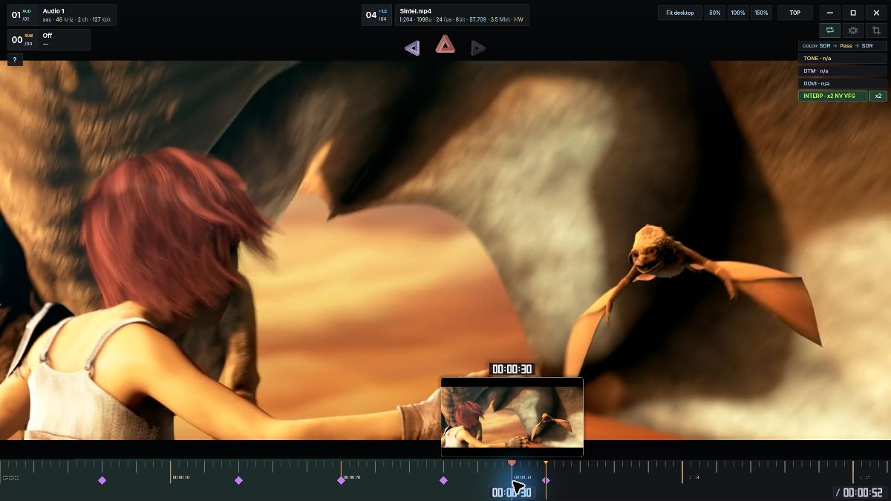
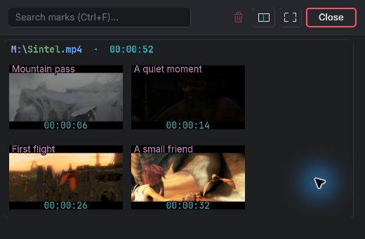
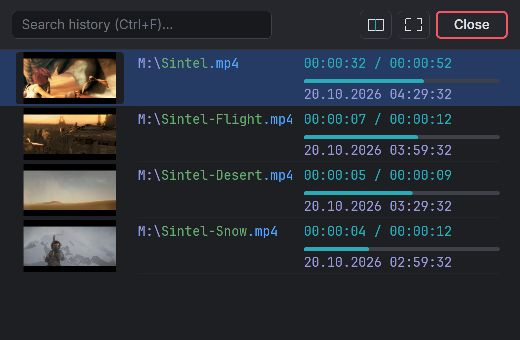

# Delta Player

**Frame generation. RTX video enhancement. Moments worth saving.**

Windows video player for high-refresh displays, HDR films and a more visual way to navigate your videos.

 

   

> **0.1.2 development preview.** Screenshots show the current development build. The public download is **0.1.1 alpha (build 1122)**; the Marks and Watch history features below are coming in 0.1.2.

| Motion that fits your display | More from your picture |
| :--- | :--- |
| **NVIDIA Video Frame Generation, RIFE and Micro Riffe**, with scene-cut detection to avoid blending across cuts. VRR-aware frame pacing. | **RTX Video Super Resolution + TrueHDR**, HDR10 / HLG, Dolby Vision metadata through HDR10 output, and dynamic tone mapping. |

<table>
<tr>
<td width="50%" valign="top">
<strong>Marks · 0.1.2 preview</strong> 
Save scenes with notes. Search thumbnail cards and jump straight back.  

</td>
<td width="50%" valign="top">
<strong>Watch history · 0.1.2 preview</strong> 
Resume from thumbnails. See saved positions, progress and dates.  

</td>
</tr>
</table>

**Around the film:** automatic black-bar cropping for ultrawide screens · Ambilight · two independent audio outputs · Steam Audio for headphones · GPU-drawn HUD and native searchable panels.

**Try it:** extract the **whole ZIP**, run `delta-player.exe` or the separate `delta-player-vulkan.exe`, and drop in a video. **F2** → settings; **F1** → controls. Portable data stays beside the app when `portable.ini` is present.

<strong>По-русски — коротко о главном</strong>

**Delta Player** — Windows-плеер с генерацией кадров, улучшением изображения RTX и наглядной навигацией по видео.

- **Плавность:** NVIDIA VFG, RIFE и Micro Riffe; детектор склеек и вывод с учётом VRR.
- **Изображение:** RTX VSR и TrueHDR, HDR10 / HLG, Dolby Vision через HDR10 и динамический тонмаппинг.
- **Метки, превью 0.1.2:** комментарии и снимки сцен, поиск, группировка по видео и переход к нужному моменту.
- **История, превью 0.1.2:** миниатюры, позиция, прогресс, дата просмотра и продолжение двойным щелчком.
- **Ещё:** автообрезка чёрных полос, Ambilight, два независимых аудиовыхода и Steam Audio для наушников. HUD рисуется на GPU, списки и поиск — в native окнах.

Скриншоты сняты в рабочей **0.1.2**. Сейчас скачивается **0.1.1 alpha, build 1122**; новые метки и история появятся в 0.1.2. Распакуйте весь ZIP и запустите один из двух exe. **F2** — настройки, **F1** — управление; в 0.1.2 **B** — метки, **H** — история.

Compatibility & screenshot credits

Windows 11 x64. Direct3D 12 requires Feature Level 12_1 / Shader Model 6.6; Vulkan is a separate executable. Features depend on the GPU, driver and display. Native NVIDIA VFG targets RTX 40 / 50; other interpolation methods have their own requirements. VRR depends on display and driver configuration. Dolby Vision Profile 7 FEL residual is not applied. This is an alpha distribution; AMD and older GPU coverage remains limited.

Screenshots: Delta Player **0.1.2, build 1192**, captured on 20 October 2026 with an isolated demonstration profile. Sample marks and history entries were prepared for this preview; panels were resized for a compact view. These SDR stills demonstrate the interface, not HDR output quality or interpolation performance.

Film frames: **© copyright Blender Foundation | [Sintel](https://durian.blender.org/)**, [CC BY 3.0](https://creativecommons.org/licenses/by/3.0/). [Trailer source](https://download.blender.org/durian/trailer/sintel_trailer-1080p.mp4). The trailer was re-encoded and excerpted for the demonstration; frames are shown inside the player UI. No affiliation or endorsement is implied. NVIDIA and other product names belong to their respective owners.

