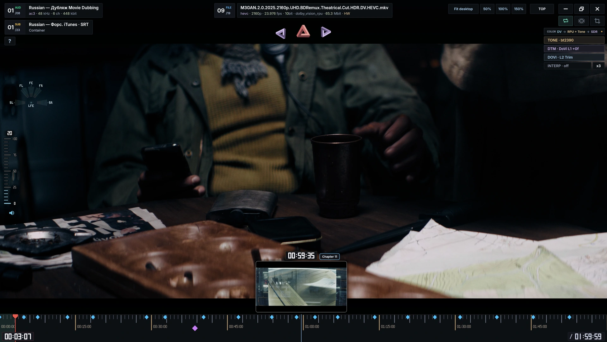
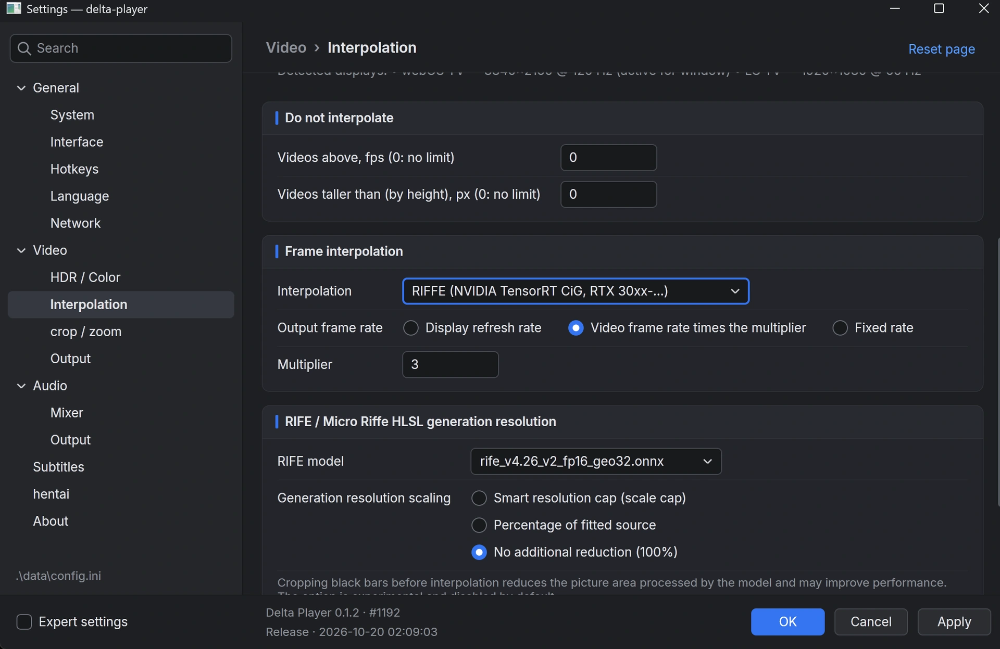
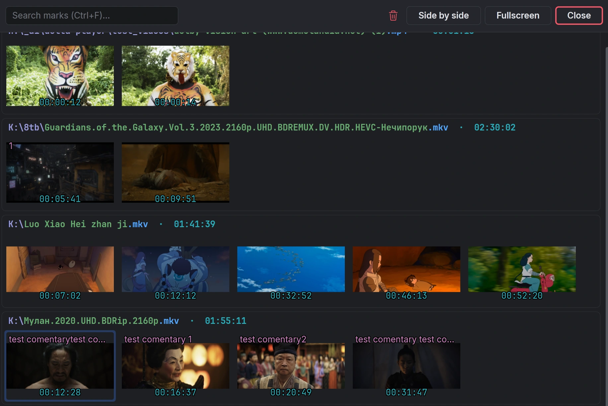
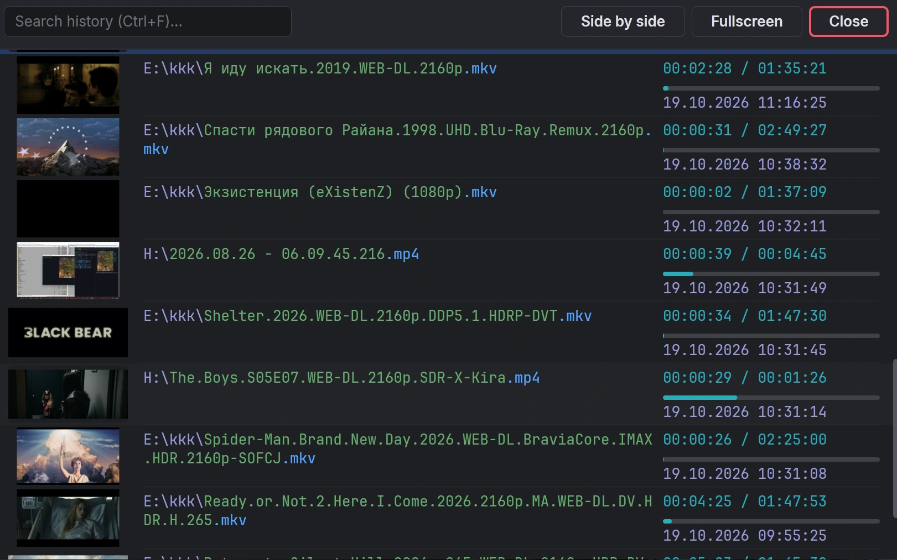

# Delta Player

**Frame generation. RTX video enhancement. Moments worth saving.**

Windows video player for high-refresh displays, HDR films and a more visual way to navigate your videos.

 

   

| Motion that fits your display | More from your picture |
| :--- | :--- |
| **NVIDIA Video Frame Generation, RIFE and Micro Riffe**, with scene-cut detection to avoid blending across cuts. VRR-aware frame pacing. | **RTX Video Super Resolution + TrueHDR**, HDR10 / HLG, Dolby Vision metadata through HDR10 output, and dynamic tone mapping. |

<table>
<tr>
<td width="50%" valign="top">
<strong>Playback HUD</strong> 
See the HDR-to-display color path and tone-mapping mode. Scrub the timeline with visual previews.  

</td>
<td width="50%" valign="top">
<strong>Frame generation controls</strong> 
Choose a backend, target your display refresh or a frame-rate multiplier, and tune generation resolution.  

</td>
</tr>
<tr>
<td width="50%" valign="top">
<strong>Marks</strong> 
Save scenes with comments. Search thumbnail cards grouped by video and jump straight back.  

</td>
<td width="50%" valign="top">
<strong>Watch history</strong> 
Resume from thumbnails. See saved positions, progress and dates.  

</td>
</tr>
</table>

**Around the film:** automatic black-bar cropping for ultrawide screens · Ambilight · two independent audio outputs · Steam Audio for headphones · GPU-drawn HUD and native searchable panels.

**Try it:** extract the **whole ZIP**, run `delta-player.exe` or the separate `delta-player-vulkan.exe`, and drop in a video. **F2** → settings; **F1** → controls. Portable data stays beside the app when `portable.ini` is present.

Compatibility

Windows 11 x64. Direct3D 12 requires Feature Level 12_1 / Shader Model 6.6; Vulkan is a separate executable. Features depend on the GPU, driver and display. Native NVIDIA VFG targets RTX 40 / 50; other interpolation methods have their own requirements. VRR depends on display and driver configuration. Dolby Vision Profile 7 FEL residual is not applied. This is an alpha distribution; AMD and older GPU coverage remains limited.

